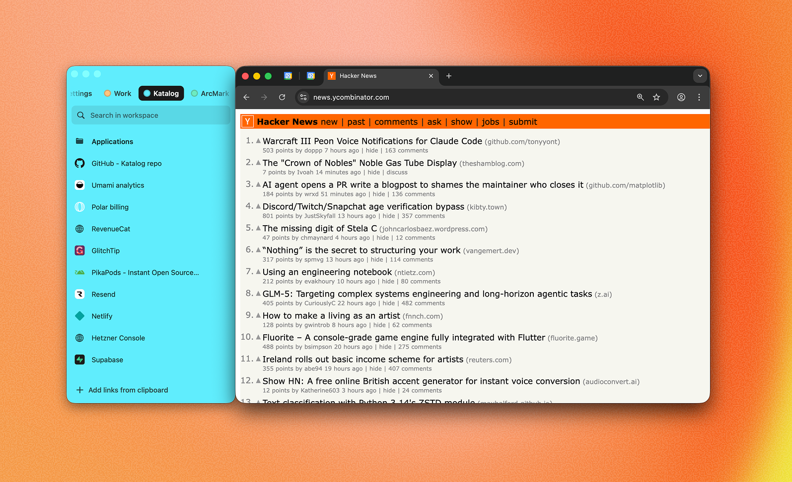
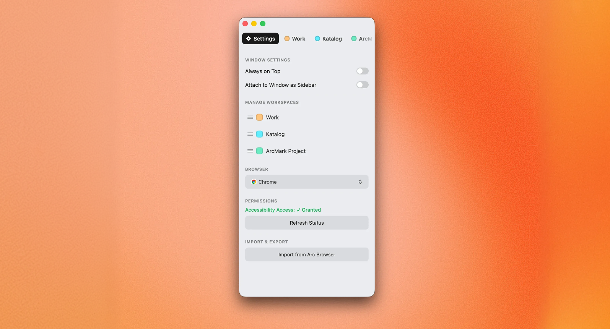

<picture>
  
</picture>

# SidebArc

<p align="center">
  
</p>

SidebArc is a native macOS bookmark manager built with Swift and AppKit that attaches to any browser window as a sidebar, organized the way Arc browser's sidebar organizes tabs.

SidebArc is a fork of Arcmark (MIT). It runs independently on the same Mac: separate bundle id, data and settings.

## Why SidebArc?

**Browser-Attached Sidebar** - Float alongside any browser window (Chrome, Arc, Safari, Brave, etc.) for instant access to your bookmarks without switching apps.

**Workspace Organization** - Organize bookmarks into multiple workspaces with custom window colors. Create nested folder hierarchies with drag-and-drop.

**Local-first** - All bookmarks stored in a single JSON file (`~/Library/Application Support/io.github.giannirondini.sidebarc/data.json`).

## Download

**Latest Release**: [Download SidebArc](https://github.com/giannirondini/sidebarc/releases/latest)

### System Requirements
- macOS 13.0 or later
- Accessibility permissions (required for browser window attachment); Not needed if you intend to use it as a standalone window.

## Features

### Browser Integration
- **Sidebar Attachment** - Automatically attaches to browser windows and follows them across spaces. If you prefer, you can still use SidebArc as a standalone bookmark manager window, not attaching it anywhere.
- **Supported Browsers** - Chrome, Arc, Safari, Brave, etc.
- **Always-on-Top Mode** - Pin the SidebArc window to stay visible on top of all apps.
- **Switch to Open Tabs** - Clicking a favorite switches to the tab where it's already open instead of opening a duplicate (Chrome, Brave, Safari); ⌥-click a list link to do the same. Firefox and other browsers always open a new tab.
- **Profiles** - Group spaces into profiles (e.g. Personal, Work). Each profile can open links in its own browser and browser profile, and shares one Favorites grid across its spaces. Any link can be set to always open in a specific browser.
- **Arc Import** - Import pinned tabs, folders and Favorites directly from Arc browser via settings; Arc profiles map to SidebArc profiles.
- **Browser Import** - Import bookmarks exported as HTML from Chrome, Safari or Firefox.

### Organization
- **Multiple Workspaces** - Separate bookmark collections with custom-colored workspaces.
- **Nested Folders** - Create hierarchical folder structures for your links.
- **Drag-and-Drop** - Reorder and move bookmarks between folders and workspaces
- **Inline Editing** - Rename folders and links directly in the list
- **Search & Filter** - Quickly find bookmarks in any workspace

<p align="center">
  
</p>

## Installation

1. Download the latest `.dmg` file from the [Releases](https://github.com/giannirondini/sidebarc/releases) page
2. Open the downloaded DMG file
3. Drag **SidebArc.app** to your **Applications** folder
4. Launch SidebArc from your Applications folder

## Setup

### Accessibility Permissions

For the sidebar attachment feature to work, grant SidebArc accessibility permissions:

1. Open **System Settings** → **Privacy & Security** → **Accessibility**
2. Click the **+** button and add **SidebArc.app**
3. Enable the checkbox next to SidebArc

Without this permission, the app will function as a standalone bookmark manager but won't attach to browser windows. The app will prompt to grant accessibility permission if the "Attach to window as sidebar" option is selected.

### Automation Permission (Switch to Open Tabs)

To find a tab that's already open, SidebArc asks Chrome, Brave or Safari for their tab URLs over Apple Events. It never reads browser data folders.

1. Open SidebArc **Settings** → **Permissions**, with the browser running
2. Click **Allow Browser Access…** and allow SidebArc to control the browser

Clicks never trigger the prompt. Without the permission, links open in a new tab as usual. To change it later: **System Settings** → **Privacy & Security** → **Automation** → **SidebArc**.

If several profiles open the same browser with different browser profiles (e.g. Chrome "Default" and "Profile 1"), switching is off for them by default: macOS can't tell which browser profile a tab belongs to, so it might switch to the wrong account. Turn it on per profile in **Settings** → **Profiles**.

### Importing from Arc

To import bookmarks from Arc browser:

1. Open SidebArc settings (⌘,)
2. Click **Import Bookmarks** and select your Arc export file

Arc stores your workspace locally in `~/Library/Application Support/Arc/StorableSidebar.json`. SidebArc parses this file to recreate exactly the same folder and spaces structure you've had previously.

## Agent Skill

SidebArc ships an agent skill in `skills/sidebarc/` that lets Claude Code (and
other skill-aware agents) organize bookmarks, folders, and notes on your
behalf while the app is running. Two ways to install it:

**Option 1 — `npx skills`** (installs into every supported agent at once):

```bash
npx skills add giannirondini/sidebarc
```

**Option 2 — copy the folder directly.** Grab `skills/sidebarc/` from this
repo and drop it into the skills directory of whichever agent you use,
for example:

```bash
# Claude Code (project-local)
cp -R skills/sidebarc .claude/skills/

# Claude Code (user-wide)
cp -R skills/sidebarc ~/.claude/skills/
```

SidebArc must be running for the skill to work — it talks to a local HTTP
server inside the app.

## Building from Source

### Prerequisites

- macOS 13.0 or later
- Swift 6.2 or later (Xcode Command Line Tools are enough)
- [Mint](https://github.com/yonaskolb/Mint): `brew install mint`

[swift-bundler](https://github.com/stackotter/swift-bundler) runs through Mint at the revision pinned in `Mintfile`; the first build installs it. See [docs/BUILD_AND_CODESIGN.md](docs/BUILD_AND_CODESIGN.md).

### Build and Run

```bash
git clone https://github.com/giannirondini/sidebarc.git
cd sidebarc

# Build and run
./scripts/run.sh

# Build only (creates .build/bundler/SidebArc.app)
./scripts/build.sh

# Create DMG installer
./scripts/build.sh --dmg
```

The app is built to `.build/bundler/SidebArc.app` and can be run directly:
```bash
open .build/bundler/SidebArc.app
```

## Contributing
For bug reports, please [open an issue](https://github.com/giannirondini/sidebarc/issues).

For other changes, feel free to a open pull requests. See [CLAUDE.md](CLAUDE.md) and `docs/` for architecture details, development guidelines, and build instructions.

## License

MIT License - see [LICENSE](LICENSE) for details
