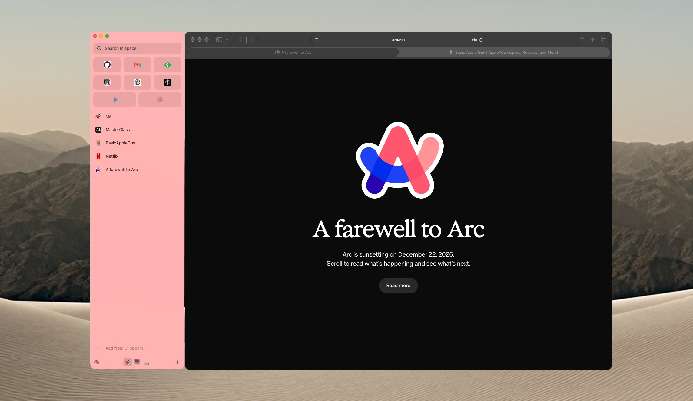
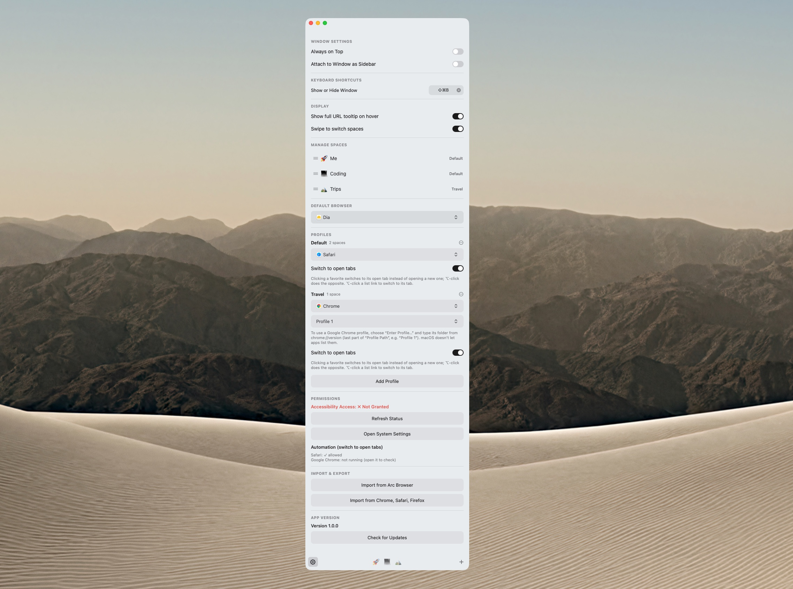

<picture>
  
</picture>

# SidebArc

<p align="center">
  
</p>

SidebArc is a native macOS bookmark manager built with Swift and AppKit that attaches to any browser window as a sidebar, organized the way Arc browser's sidebar organizes tabs.

SidebArc is a fork of Arcmark (MIT). It runs independently on the same Mac: separate bundle id, data and settings.

## Why SidebArc?

**Browser-Attached Sidebar** - Float alongside any browser window (Chrome, Arc, Safari, Brave, etc.) for instant access to your bookmarks without switching apps.

**Spaces, like Arc** - Organize bookmarks into spaces, each with its own colour and icon, and switch between them from the space bar, the keyboard or a two-finger swipe. Create nested folder hierarchies with drag-and-drop.

**Local-first** - All bookmarks stored in a single JSON file (`~/Library/Application Support/io.github.giannirondini.sidebarc/data.json`).

## Download

No release has been published yet: for now, [build it from source](#building-from-source). Releases will appear on the [Releases page](https://github.com/giannirondini/sidebarc/releases) as a DMG.

### System Requirements
- macOS 13.0 or later
- Accessibility permissions (required for browser window attachment); Not needed if you intend to use it as a standalone window.

## Features

### Browser Integration
- **Sidebar Attachment** - Attaches to the window of whichever browser your profiles use (or your default browser) is in front, and follows it as you move or resize it; switch from Chrome to Safari and the sidebar follows. Resize the attached sidebar and it keeps that width. If you prefer, you can still use SidebArc as a standalone window, not attached anywhere.
- **Supported Browsers** - Attachment works with any browser (Chrome, Arc, Safari, Brave, Firefox, etc.).
- **Always-on-Top Mode** - Pin the SidebArc window to stay visible on top of all apps.
- **Switch to Open Tabs** - Clicking a favorite switches to the tab where it's already open instead of opening a duplicate (Chrome, Brave, Safari); ⌥-click a list link to do the same. Firefox and other browsers always open a new tab.
- **Profiles** - Group spaces into profiles (e.g. Personal, Work). Each profile can open links in its own browser and browser profile, and shares one Favorites grid across its spaces. Any link can be set to always open in a specific browser.
- **Arc Import** - Import pinned tabs, folders and Favorites directly from Arc browser via settings; Arc profiles map to SidebArc profiles.
- **Browser Import** - Import bookmarks exported as HTML from Chrome, Safari or Firefox.
- **Export and Import** - Move everything (spaces, Favorites, profiles, notes, icons) to another Mac with **Settings** → **Import & Export** → **Export Data…** / **Import Data…**. Importing replaces your data after a confirmation and backs up the previous data; a readable backup can be imported to undo.

### Organization
- **Spaces** - Separate bookmark collections. Switch with the space bar at the bottom, ⌘⌥← / ⌘⌥→, or a horizontal two-finger swipe (turn on **Swipe to switch spaces** in Settings).
- **Colours and Icons** - 16 colours per space, or any colour with its opacity (Change Color → Custom Color…): below 100% the sidebar turns frosted. Give spaces, links and notes an emoji (searchable) or a symbol.
- **Favorites** - A grid of tiles at the top, shared by the spaces of a profile.
- **Nested Folders** - Create hierarchical folder structures for your links.
- **Notes** - Markdown notes alongside your links.
- **Scheduled Links** - Have a link open by itself at a set time.
- **Drag-and-Drop** - Reorder and move bookmarks between folders and spaces
- **Any Kind of Link** - Web pages, files and app links (`mailto:`, `obsidian://`, `slack://`, …): paste a URL, or right-click the list and choose **New Link…** (in a folder: **New Link in Folder…**). Typing `example.com` is enough. App links open in their app; a link to an app or script is shown in Finder instead of run.
- **Inline Editing** - Rename folders and links directly in the list
- **Search & Filter** - Quickly find bookmarks in any space

SidebArc requests titles and favicons from bookmarked sites. When a public site's own favicon can't be fetched, it asks Google's favicon service, sending only the site's origin (scheme, host and port). Local and private hosts (`.local`, `.internal`, single-word names, IP addresses, …) are never sent; turn the fallback off entirely with **Ask Google for missing favicons** in Settings.

<p align="center">
  
</p>

## Installation

Once a release is published:

1. Download the latest `.dmg` file from the [Releases](https://github.com/giannirondini/sidebarc/releases) page
2. Open the downloaded DMG file
3. Drag **SidebArc.app** to your **Applications** folder
4. SidebArc is signed but not notarized by Apple (that needs a paid developer account), so macOS blocks it the first time. Clear the download's quarantine flag once per new version:
   ```bash
   xattr -dr com.apple.quarantine /Applications/SidebArc.app
   ```
   (Or **System Settings** → **Privacy & Security** → **Open Anyway**.)
5. Launch SidebArc from your Applications folder

Permissions carry over between releases. Your data lives in `~/Library/Application Support/io.github.giannirondini.sidebarc/` and is kept when you update.

## Setup

### Accessibility Permissions

For the sidebar attachment feature to work, grant SidebArc accessibility permissions:

1. Open **System Settings** → **Privacy & Security** → **Accessibility**
2. Click the **+** button and add **SidebArc.app**
3. Enable the checkbox next to SidebArc

Without this permission, the app will function as a standalone bookmark manager but won't attach to browser windows. Enabling **Attach to Window as Sidebar** in Settings without permission shows a reminder.

If permission is revoked, SidebArc returns to a movable standalone window without clearing the attachment preference. After granting access again, toggle attachment off and on in Settings (or restart the app) to reattach.

If you build SidebArc yourself and later change how it's signed (e.g. from ad-hoc to a certificate), macOS keeps the old grant but it no longer matches: run `tccutil reset Accessibility io.github.giannirondini.sidebarc` and grant it again.

### Automation Permission (Switch to Open Tabs)

To find a tab that's already open, SidebArc asks Chrome, Brave or Safari for their tab URLs over Apple Events. It never reads browser data folders.

1. Open SidebArc **Settings** → **Permissions**, with the browser running
2. Click **Allow Browser Access…** and allow SidebArc to control the browser

Clicks never trigger the prompt. Without the permission, links open in a new tab as usual. To change it later: **System Settings** → **Privacy & Security** → **Automation** → **SidebArc**.

If several profiles open the same browser with different browser profiles (e.g. Chrome "Default" and "Profile 1"), switching is off for them by default: macOS can't tell which browser profile a tab belongs to, so it might switch to the wrong account. Turn it on per profile in **Settings** → **Profiles**.

### Importing from Arc

To import bookmarks from Arc browser:

1. Open SidebArc settings (⌘,)
2. Click **Import from Arc Browser**

SidebArc reads Arc's sidebar file directly from `~/Library/Application Support/Arc/StorableSidebar.json` (no file to pick) and recreates your spaces with their pinned tabs and folders, plus each Arc profile's Favorites. Your existing spaces are kept.

## Agent Skill

SidebArc ships an agent skill in `skills/sidebarc/` that lets Claude Code (and
other skill-aware agents) organize bookmarks, folders, and notes on your
behalf while the app is running. Two ways to install it:

**Option 1 — `npx skills`** (installs into every supported agent at once):

```bash
npx skills add giannirondini/sidebarc
```

**Option 2 — copy the folder directly.** Grab `skills/sidebarc/` from this
repo and drop it into the skills directory of whichever agent you use,
for example:

```bash
# Claude Code (project-local)
cp -R skills/sidebarc .claude/skills/

# Claude Code (user-wide)
cp -R skills/sidebarc ~/.claude/skills/
```

SidebArc must be running for the skill to work — it talks to a local HTTP
server inside the app.

## Building from Source

### Prerequisites

- macOS 13.0 or later
- Swift 6.2 or later (Xcode Command Line Tools are enough)
- [Mint](https://github.com/yonaskolb/Mint): `brew install mint`

[swift-bundler](https://github.com/stackotter/swift-bundler) runs through Mint at the revision pinned in `Mintfile`; the first build installs it. See [docs/BUILD_AND_CODESIGN.md](docs/BUILD_AND_CODESIGN.md).

### Build and Run

```bash
git clone https://github.com/giannirondini/sidebarc.git
cd sidebarc

# Build and run
./scripts/run.sh

# Build only (creates .build/bundler/SidebArc.app)
./scripts/build.sh

# Create the DMG and release files (brew install create-dmg; see scripts/README.md)
./scripts/create-dmg.sh --allow-adhoc   # without a signing certificate: a local test DMG
```

Builds are signed ad-hoc unless you set up a local signing certificate (`.signing-config`), which keeps privacy permissions stable across rebuilds: see [Code signing](docs/BUILD_AND_CODESIGN.md#code-signing).

The app is built to `.build/bundler/SidebArc.app` and can be run directly:
```bash
open .build/bundler/SidebArc.app
```

## Contributing
For bug reports, please [open an issue](https://github.com/giannirondini/sidebarc/issues).

For other changes, feel free to open a pull request. See [CLAUDE.md](CLAUDE.md) and `docs/` for architecture details, development guidelines, and build instructions.

## License

MIT License - see [LICENSE](LICENSE) for details
